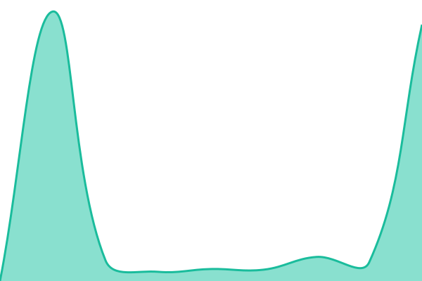
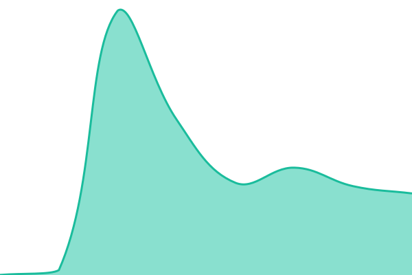
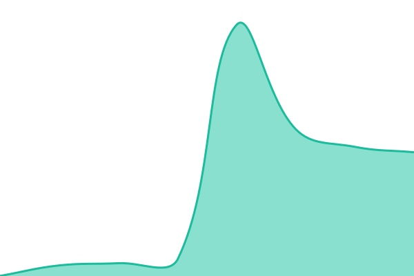
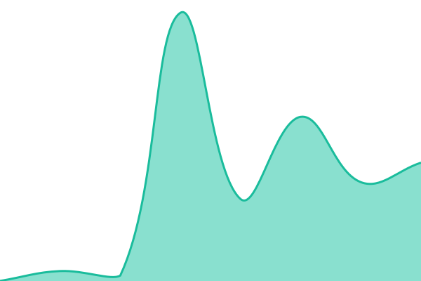
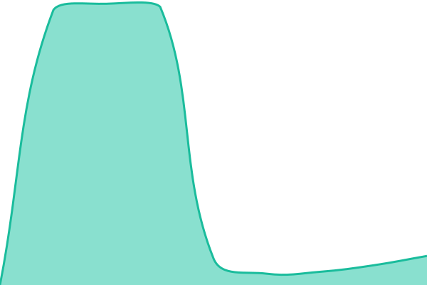

# [📈 Live Status](https://status.gadupec.com.br): <!--live status--> **🟥 Complete outage**

This repository contains the open-source uptime monitor and status page for [arantides](https://status.gadupec.com.br), powered by [Upptime](https://github.com/upptime/upptime).

With [Upptime](https://upptime.js.org), you can get your own unlimited and free uptime monitor and status page, powered entirely by a GitHub repository. We use [Issues](https://github.com/arantides/upptime/issues) as incident reports, [Actions](https://github.com/arantides/upptime/actions) as uptime monitors, and [Pages](https://status.gadupec.com.br) for the status page.

<!--start: status pages-->
<!-- This summary is generated by Upptime (https://github.com/upptime/upptime) -->
<!-- Do not edit this manually, your changes will be overwritten -->
<!-- prettier-ignore -->
| URL | Status | History | Response Time | Uptime |
| --- | ------ | ------- | ------------- | ------ |
|  [Portal GADUPEC](https://www.gadupec.com.br) | 🟥 Down | [portal-gadupec.yml](https://github.com/arantides/upptime/commits/HEAD/history/portal-gadupec.yml) | 

 374ms
     
 | 

<a href="https://status.gadupec.com.br/history/portal-gadupec">54.03%</a>
    

|  [Pecuária](https://pecuaria.gadupec.com.br) | 🟥 Down | [pecuaria.yml](https://github.com/arantides/upptime/commits/HEAD/history/pecuaria.yml) | 

 1064ms
     
 | 

<a href="https://status.gadupec.com.br/history/pecuaria">54.03%</a>
    

|  [Confinamento](https://confinamento.gadupec.com.br) | 🟥 Down | [confinamento.yml](https://github.com/arantides/upptime/commits/HEAD/history/confinamento.yml) | 

 1082ms
     
 | 

<a href="https://status.gadupec.com.br/history/confinamento">54.03%</a>
    

|  [Financeiro](https://financeiro.gadupec.com.br) | 🟥 Down | [financeiro.yml](https://github.com/arantides/upptime/commits/HEAD/history/financeiro.yml) | 

 982ms
     
 | 

<a href="https://status.gadupec.com.br/history/financeiro">54.03%</a>
    

|  [Compras](https://compras.gadupec.com.br) | 🟥 Down | [compras.yml](https://github.com/arantides/upptime/commits/HEAD/history/compras.yml) | 

 1056ms
     
 | 

<a href="https://status.gadupec.com.br/history/compras">54.04%</a>
    

|  [Estoque (Almoxarifado)](https://almox.gadupec.com.br) | 🟥 Down | [estoque-almoxarifado.yml](https://github.com/arantides/upptime/commits/HEAD/history/estoque-almoxarifado.yml) | 

 1079ms
     
 | 

<a href="https://status.gadupec.com.br/history/estoque-almoxarifado">54.04%</a>
    

|  [Clima](https://clima.gadupec.com.br) | 🟥 Down | [clima.yml](https://github.com/arantides/upptime/commits/HEAD/history/clima.yml) | 

 1001ms
     
 | 

<a href="https://status.gadupec.com.br/history/clima">54.04%</a>
    

|  [Frotas](https://frotas.gadupec.com.br) | 🟥 Down | [frotas.yml](https://github.com/arantides/upptime/commits/HEAD/history/frotas.yml) | 

 1031ms
     
 | 

<a href="https://status.gadupec.com.br/history/frotas">54.04%</a>
    

|  [Patrimônio](https://patrimonio.gadupec.com.br) | 🟥 Down | [patrimonio.yml](https://github.com/arantides/upptime/commits/HEAD/history/patrimonio.yml) | 

 1123ms
     
 | 

<a href="https://status.gadupec.com.br/history/patrimonio">54.04%</a>
    

|  [Protocolo](https://protocolo.gadupec.com.br) | 🟥 Down | [protocolo.yml](https://github.com/arantides/upptime/commits/HEAD/history/protocolo.yml) | 

 1025ms
     
 | 

<a href="https://status.gadupec.com.br/history/protocolo">54.05%</a>
    

|  [Gestão](https://gestao.gadupec.com.br) | 🟥 Down | [gestao.yml](https://github.com/arantides/upptime/commits/HEAD/history/gestao.yml) | 

 1035ms
     
 | 

<a href="https://status.gadupec.com.br/history/gestao">54.05%</a>
    

<!--end: status pages-->

[**Visit our status website →**](https://status.gadupec.com.br)

## 📄 License

- Powered by: [Upptime](https://github.com/upptime/upptime)
- Code: [MIT](./LICENSE) © [Anand Chowdhary](https://anandchowdhary.com)
- Data in the `./history` directory: [Open Database License](https://opendatacommons.org/licenses/odbl/1-0/)
